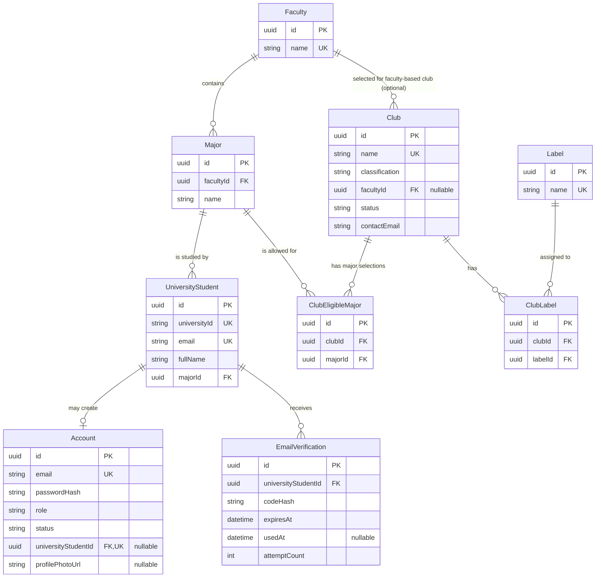

# ClubHub — Initial Database Design & Relationship Register (V1)

**Date:** 11 October 2026  
**Status:** Design draft for team review; **not a migration or an approved implementation**  
**Scope:** One PostgreSQL database for ClubHub; small sample university-student roster; real registration/verification/sign-in; public clubs directory. Other features will arrive through later migrations.  
**Related documents:** `docs/clubs-platform-sprint-plan.md` (original sequence), `docs/database-design-review.md` (working requirements and differences). **This document records decisions made after those drafts and supersedes them where noted.**

## 1. Goal, boundaries, and vocabulary

**First demonstrable slice:** Seed 4–5 consenting university students locally; a previously unregistered student enters their university email, verifies ownership via a real email, sets a password, signs in, and sees active clubs served from PostgreSQL via `/api/v1/clubs`.

- **One database**, tentatively `clubhub_dev`; `UniversityStudent` is an ordinary table in that database, **not** a second university DB or a separate simulated platform.
- **UniversityStudent ≠ Account.** University roster records may exist without a ClubHub account. Student-owned ClubHub accounts link to exactly one roster record; a roster record can link to **zero or one** account.
- **Email format:** `s<universityId>@stu.najah.edu` (e.g. `s12217434@stu.najah.edu`). The example is a format illustration, **not permission to seed that person's details**.
- **First slice only:** faculty/major catalog, sample roster, signup verification, account/authentication, clubs, eligibility configured at club creation, and club labels. Memberships, payments, events, approvals, club admin/supervisor accounts, and more come later.
- **Field notation:** `PK` = primary key; `FK` = foreign key; `UQ` = unique; `NN` = not null; `?` = nullable/optional; `1:N` = one-to-many; `1:0..1` = one-to-zero-or-one.
- **Global conventions:** every persisted table has `id UUID PK`, `createdAt TIMESTAMPTZ NN`, and `updatedAt TIMESTAMPTZ NN`; enums represent statuses and roles. Time logic uses the backend's clock. Prisma models map to PostgreSQL types as indicated below.

> **Boundary on certainty:** Names, field sizes, indexes, and token lifecycle details below are engineering **proposals** until the implementation review. University student identity rules, club classification, active/archived visibility, and other explicitly agreed behavior are **confirmed**.

## 2. Entity inventory

| Entity | Purpose | In first slice? |
|---|---|---|
| `Faculty` | Canonical faculty reference list | Yes |
| `Major` | Canonical majors, each within one faculty | Yes |
| `UniversityStudent` | Local, privately populated university roster, account-independent | Yes |
| `Account` | Registered ClubHub login identities and password hashes | Yes |
| `EmailVerification` | Temporary one-time email verification challenges | Yes |
| `Club` | Clubs, profile information, classification, public status | Yes |
| `ClubEligibleMajor` | Major allowlist for a major-based club | Yes |
| `Label` | Interest/search tag vocabulary | Yes |
| `ClubLabel` | Many-to-many club/label association | Yes |

**Nine tables** total. `RefreshSession` is **not** in the initial table list; secure refresh/logout implementation remains a required authentication design decision prior to claiming Sprint 1 is complete (original sprint plan calls for refresh and logout). Do not pretend JWT logout/revocation works without appropriate server-side strategy. If the chosen refresh design needs a persistence table, add it in a focused migration.

## 3. Table-by-table dictionary

Types are **PostgreSQL logical types** (Prisma will use `String @db.Uuid`, `String @db.VarChar(...)`, `DateTime @db.Timestamptz`, etc.). Every record uses a real UUID, not display IDs such as `F001`.

### 3.1 `Faculty`

**Why:** A controlled, reusable academic classification. A faculty is not entered as free text on each student or club.

| Field | Type | Keys / rules | Why it exists |
|---|---|---|---|
| `id` | UUID | PK, NN | Stable faculty identifier for references |
| `name` | VARCHAR(150) | UQ, NN | Official faculty label in UI |
| `createdAt` | TIMESTAMPTZ | NN | Audit provenance |
| `updatedAt` | TIMESTAMPTZ | NN | Detect/reference changes |

**Relationships:** One faculty has **zero or many majors** (`Faculty 1 → Major 0..N`). A faculty may have **zero or many faculty-based clubs** (`Faculty 1 → Club 0..N`); a faculty-based club must reference exactly one faculty. The faculty listing should reflect the university structure; verify actual names before seeding. **Deletion:** block while referenced, otherwise prefer non-destructive administration in future.

### 3.2 `Major`

**Why:** A student belongs to one major; that major establishes the student's faculty and supports major-based club eligibility.

| Field | Type | Keys / rules | Why it exists |
|---|---|---|---|
| `id` | UUID | PK, NN | Stable identifier |
| `name` | VARCHAR(150) | NN; UQ together with `facultyId` | Name within a faculty |
| `facultyId` | UUID | FK → `Faculty.id`, NN | Which faculty offers the major |
| `createdAt` | TIMESTAMPTZ | NN | Creation tracking |
| `updatedAt` | TIMESTAMPTZ | NN | Update tracking |

**Constraint:** `UNIQUE(facultyId, name)`. **Relationships:** Each major belongs to **exactly one** faculty (`Major N → Faculty 1`); one major can have **zero or many** university students and **zero or many** `ClubEligibleMajor` rows. Do not store an independent faculty ID on `UniversityStudent`; derive it via `Major.facultyId` to avoid mismatches. Prevent deletion while used.

### 3.3 `UniversityStudent`

**Why:** Represents the university roster even for people who have never used ClubHub. Contains academic identity only, **never passwords**.

| Field | Type | Keys / rules | Why it exists |
|---|---|---|---|
| `id` | UUID | PK, NN | Internal stable FK target |
| `universityId` | VARCHAR(20) | UQ, NN | Official student identifier, stored as text (retains leading zeros if any) |
| `email` | VARCHAR(255) | UQ, NN | University inbox used for identity lookup and verification |
| `fullName` | VARCHAR(150) | NN | University-controlled display name |
| `majorId` | UUID | FK → `Major.id`, NN | Academic major; faculty derives from it |
| `createdAt` | TIMESTAMPTZ | NN | Local roster entry creation |
| `updatedAt` | TIMESTAMPTZ | NN | Local roster modification; allows future sync checks |

**Validation:** Normalize email to lowercase; for these student records, email must equal `s${universityId}@stu.najah.edu`. Implement application validation; optional DB CHECK later. Do not auto-invent actual roster details. A change to `majorId` updates the derived faculty automatically. In this initial local simulation, roster changes require an authorized update (not an actual university integration). **Relationships:** each university student belongs to **one** major; has **zero or one** `Account`, and **zero or many** verification challenges.

### 3.4 `Account`

**Why:** Holds actual ClubHub authentication identities; distinct from the student roster. Eventually also represents shared club, supervisor, and Deanship logins.

| Field | Type | Keys / rules | Why it exists |
|---|---|---|---|
| `id` | UUID | PK, NN | Authentication principal |
| `email` | VARCHAR(255) | UQ, NN | Normalized sign-in identifier |
| `passwordHash` | VARCHAR(255) | NN for completed account | Safely hashed password (Argon2id or equivalent), never plaintext |
| `role` | `AccountRole` ENUM | NN | Permissions; `STUDENT`, `CLUB`, `SUPERVISOR`, `DEANSHIP` |
| `status` | `AccountStatus` ENUM | NN | `ACTIVE`, `DISABLED`; separate from email challenge state |
| `universityStudentId` | UUID | FK → `UniversityStudent.id`, UQ, nullable (`?`) | Links student account to roster; non-student roles need no student link |
| `profilePhotoUrl` | TEXT | `?` | User-controlled profile image location, not file bytes |
| `createdAt` | TIMESTAMPTZ | NN | Account creation time |
| `updatedAt` | TIMESTAMPTZ | NN | Last update |

**Relationships:** each roster student has **zero or one** account; each `STUDENT` account has **exactly one** roster student. Non-student accounts have no student link in this phase. The optional unique FK models `UniversityStudent 1 ↔ Account 0..1`; a DB-level check or service validation must enforce **role = STUDENT ⇒ universityStudentId NOT NULL** and the inverse requirement for nonstudent accounts as approved later. For students, account email must match roster email at creation; plan how to handle later email changes before adding that feature. **No automatic account creation when seeding `UniversityStudent`.** Student accounts are created through successful verification and password setup.

**Proposed signup integrity:** do not create a usable Account before the verification/password transaction completes. Avoid creating a second registration when `Account.universityStudentId` already exists. Do not let `profilePhotoUrl` permit arbitrary unsafe URLs/uploads.

### 3.5 `EmailVerification`

**Why:** Makes actual emailed verification possible without putting codes/passwords in the university roster. Separates a temporary signup challenge from an authenticated account.

| Field | Type | Keys / rules | Why it exists |
|---|---|---|---|
| `id` | UUID | PK, NN | Unique verification attempt/challenge |
| `universityStudentId` | UUID | FK → `UniversityStudent.id`, NN | Who can finish this signup |
| `codeHash` | VARCHAR(255) | NN | Hashed/HMAC-protected one-time code; never raw code |
| `expiresAt` | TIMESTAMPTZ | NN | Hard expiry |
| `usedAt` | TIMESTAMPTZ | `?` | Single-use marker |
| `attemptCount` | INTEGER | NN, default `0` | Bound guessing attempts |
| `createdAt` | TIMESTAMPTZ | NN | When challenge was issued |
| `updatedAt` | TIMESTAMPTZ | NN | Challenge state updates |

**Relationships:** a student can have **zero or many** challenges; every challenge belongs to **exactly one** student. **Business protections:** expire codes, throttle issuance, cap attempts, invalidate replaced challenges, avoid account/email enumeration where appropriate, and bind proof of verification securely to password creation (for example a short-lived, single-use server-issued signup completion token/transaction). A `usedAt` timestamp alone does **not** prove that the client completing signup owns the verified email. Specify the completion protocol and email sender before implementing this endpoint.

### 3.6 `Club`

**Why:** Primary source for public directory and club profile; status determines visibility. Club eligibility is configured **at creation**, not a separate free-floating interpretation.

| Field | Type | Keys / rules | Why it exists |
|---|---|---|---|
| `id` | UUID | PK, NN | Stable club identifier |
| `name` | VARCHAR(150) | UQ, NN | Directory/profile title |
| `description` | TEXT | NN | Club profile overview |
| `logoUrl` | TEXT | `?` | Reference to a stored club image (later file-storage flow) |
| `classification` | `ClubClassification` ENUM | NN | Exactly one of `GENERAL`, `FACULTY_BASED`, `MAJOR_BASED` |
| `facultyId` | UUID | FK → `Faculty.id`, nullable (`?`) | The **one** eligible faculty, only for faculty-based clubs |
| `status` | `ClubStatus` ENUM | NN | `ACTIVE` or `ARCHIVED`; public API shows active only |
| `foundedYear` | INTEGER | `?` | Historical info displayed on profile |
| `contactEmail` | VARCHAR(255) | NN (decision) | The club's **own** contact email; not necessarily its shared login |
| `meetingInfo` | TEXT | `?` | Meeting schedule/location text in UI |
| `createdAt` | TIMESTAMPTZ | NN | Record creation |
| `updatedAt` | TIMESTAMPTZ | NN | Last modification |

**Classification rules (agreed):**

| `classification` | `facultyId` | `ClubEligibleMajor` rows | Students eligible |
|---|---|---|---|
| `GENERAL` | `NULL` | None | All university students |
| `FACULTY_BASED` | Required, exactly one | None | All students whose major belongs to that faculty |
| `MAJOR_BASED` | `NULL` | **At least one** | Students belonging to **any** selected major; majors may span faculties |

**Atomic creation:** because eligibility cannot be omitted, create club + eligible-major rows together in one transaction. A `MAJOR_BASED` club cannot be activated/created without its required major selection. The multirow “at least one” rule needs a transactional service rule (simple row CHECK constraints alone cannot enforce it). An explicit `CHECK` can enforce the `facultyId`/classification combination. An archived club stays in storage; do not hard-delete historical clubs. Later fields (supervisor, shared admin, board, fee, join window, membership count) are **not** faked in this slice. `memberCount` will be derived from memberships when those tables exist.

### 3.7 `ClubEligibleMajor`

**Why:** Represents the selection of multiple eligible majors for a single major-based club; each row selects one major.

| Field | Type | Keys / rules | Why it exists |
|---|---|---|---|
| `id` | UUID | PK, NN | Consistent base-entity convention |
| `clubId` | UUID | FK → `Club.id`, NN | Which club permits the major |
| `majorId` | UUID | FK → `Major.id`, NN | Which major is permitted |
| `createdAt` | TIMESTAMPTZ | NN | Assignment tracking |
| `updatedAt` | TIMESTAMPTZ | NN | Update tracking |

**Constraint:** `UNIQUE(clubId, majorId)` prevents duplicates. **Relationships:** one major-based club has **1..N** selected majors (business rule), each eligible-major row belongs to **one** club and **one** major; a major may appear on **zero or many** clubs. Reject rows attached to general/faculty-based clubs. No redundant independent `EligibilityRule` table in V1.

### 3.8 `Label`

**Why:** Descriptive category/interest chips for directory filtering; **not membership eligibility**.

| Field | Type | Keys / rules | Why it exists |
|---|---|---|---|
| `id` | UUID | PK, NN | Tag identity |
| `name` | VARCHAR(80) | UQ, NN | Label displayed to users (e.g., Technology) |
| `createdAt` | TIMESTAMPTZ | NN | Tracking |
| `updatedAt` | TIMESTAMPTZ | NN | Tracking |

One label can be attached to **zero or many** clubs through `ClubLabel`. Normalize case/spacing to avoid duplicate labels.

### 3.9 `ClubLabel`

**Why:** Resolves a many-to-many relationship: clubs can have multiple labels; labels can be reused by multiple clubs.

| Field | Type | Keys / rules | Why it exists |
|---|---|---|---|
| `id` | UUID | PK, NN | Junction record identity |
| `clubId` | UUID | FK → `Club.id`, NN | Tagged club |
| `labelId` | UUID | FK → `Label.id`, NN | Assigned label |
| `createdAt` | TIMESTAMPTZ | NN | When assigned |
| `updatedAt` | TIMESTAMPTZ | NN | Tracking |

**Constraint:** `UNIQUE(clubId, labelId)`; zero labels is allowed until the UI requirement says otherwise. Labels affect filters and display, **not** who may join.

## 4. Entity relationship diagram (Mermaid ERD)

Paste this Markdown in a Mermaid-enabled renderer (e.g., GitHub). Cardinality legend: `||` exactly one; `o|` zero or one; `o{` zero or many; `|{` one or many.

**ERD caveats:** The `Faculty → Club` edge only applies when `Club.classification = FACULTY_BASED`. For `MAJOR_BASED` clubs the actual minimum is **1 eligible major**, while other club classifications require **0** eligible majors; conditional cardinality is a business constraint, not expressible by one ordinary ERD edge. All tables additionally have `createdAt` and `updatedAt` (omitted from the drawing for legibility).

## 5. Relationships explained in plain language

| Link | Cardinality | Human-readable rule |
|---|---|---|
| `Faculty` → `Major` | `1 : 0..N` | One faculty may offer many majors; each major belongs to exactly one faculty. |
| `Major` → `UniversityStudent` | `1 : 0..N` | One major may have many students; each roster student has exactly one current major. |
| `UniversityStudent` → `Account` | `1 : 0..1` | A university student may have **no** ClubHub account or **one**; every student-role ClubHub account corresponds to **one** roster student. |
| `UniversityStudent` → `EmailVerification` | `1 : 0..N` | One student may request many codes over time; each code belongs to one student. |
| `Faculty` → `Club` | `1 : 0..N` conditional | One faculty may be the faculty of many faculty-based clubs; each faculty-based club selects exactly one faculty. Other classifications select none. |
| `Club` → `ClubEligibleMajor` | `1 : 0..N` physical; **1..N if major-based** | A major-based club needs at least one allowed major; general/faculty-based clubs have no such rows. |
| `Major` → `ClubEligibleMajor` | `1 : 0..N` | One major may qualify students for many clubs. |
| `Club` ↔ `Label` | `M : N` through `ClubLabel` | A club may have many tags; one tag may describe many clubs. |

## 6. End-to-end first-slice behaviors and checks

### Registration

1. Student enters `s<universityId>@stu.najah.edu`; backend normalizes and validates format.
2. Backend finds matching `UniversityStudent`; the row may exist **without** an `Account`.
3. Backend confirms there is no account for that roster student, creates a restricted, time-limited email challenge, and sends a real email using configured credentials (never embed sender secrets in Git).
4. Student proves control of the email; code can be used once and expires. Completion remains tied to that exact challenge/student, not simply a `verified=true` lookup.
5. Student sets a password; backend hashes it and **atomically** creates one student `Account` linked to the roster student. Duplicate email/roster FK are protected by UQ constraints.
6. Student signs in; authenticated `/auth/me` returns identity with academic fields derived from the roster (`Major → Faculty`). Never return hashes or verification secrets to frontend.

**Security / product checks:** invalid/expired/reused code; max attempts; repeated code requests; duplicate registration; wrong password; inactive account; nonexisting roster record; mismatched email/ID; database uniqueness under simultaneous registration. Account session/refresh/logout mechanics need a separate explicit implementation decision and tests.

### Club directory

- `GET /api/v1/clubs`: only `ACTIVE` clubs, paginated with `total` active clubs in response. Public headline uses **global active total**, not filtered/page items; filtering never inadvertently modifies it.
- `GET /api/v1/clubs/:id`: public active details; archived details only to authorized management roles later.
- Filters: name/description, `classification`, label; eligibility shown according to class and university major/faculty. When not signed in, don't claim student-specific eligibility.
- Loading, empty, and error are separate frontend states. **No fake member count, fee, supervisor, or event data** before supporting tables exist. Do not expose half-configured active clubs.

## 7. Seed data & privacy protocol

- Initial **4–5 consenting real-email testers** entered **privately by the developer**. This document contains **no real names, university IDs, or student email addresses**. Never commit those records, inbox verification codes, passwords, screenshots with personal data, or SMTP credentials.
- Use a **Git-ignored local seed input** or manual local records. Keep a committed `*.example` template containing only fictional values and instructions. Confirm friends consent before sending messages to their addresses.
- Seed faculties/majors corresponding to tester majors and selected clubs; verify actual university catalog names. Seed a small handful of clubs and labels using approved nonprivate information; do not assert that sample clubs are official real-world organizations without verification.
- Initially seed **unregistered** roster students; create accounts through the real signup flow so it is actually tested. Repeatable seed scripts must avoid wiping created test accounts unexpectedly; use a separate resettable test database for automated tests.
- **Local verification:** real email delivery can be tested with a properly configured email sender. A console/mail-capture sender is useful for automated testing, but must not be confused with a real inbox delivery test.

## 8. How V1 can grow without getting lost

**Add new tables only when their vertical slice is ready, with migration → service/repository → API → test → UI wiring.** Do not silently add fields because Figma has a visual component. Add requirements and traceability notes to the design review and implementation tracker.

| Later area | Likely future entities/fields (not in V1) | Preserved rule / risk |
|---|---|---|
| Club administration / people | `SupervisorProfile`, `SupervisorAssignment`, shared club-admin account relation, `BoardAppointment` (references **UniversityStudent** even without Account) | Exactly one shared admin account per club; one supervisor; audit caveat for shared credentials |
| Membership | `AcademicYear`, `ClubFee`, registration window, `MembershipApplication`, `Membership`, payment records | Deanship controls fees; paid only; academic-year fee versions; individual memberships last one year from activation; no early renewal; windows restrict renewals too |
| Payments | `Payment`, attempts/provider references, later `Refund` | Real gateway adapter can replace simulated online flow; manual confirmation happens immediately at point of cash payment; deadlines enforced |
| Events | `Event`, `EventClub` invitations, `EventRevision`, `EventApproval`, registrations, attendance, certificates | Parallel approval by required supervisors + Deanship; organizer-owned core details; collaboration consent; cancellation by all participating clubs; revisions require new approval |
| Communications & finance | `Announcement`, `Notification`, `EventExpense`, audit tables | Event changes announced **only to registrants** and individually notified; collaborator dashboard reads shared authorized event data |
| Sessions & identity | Session/refresh persistence if needed, password reset, future university integration | Keep registration identity independent of roster and ensure secure logout/revocation |

**Avoid schema traps now:** Do not make `Club.memberCount` a writable counter. Do not put membership fees or event budget directly into V1 as placeholders. Do not store redundant student `facultyId` if `Major` defines faculty. Do not put login secrets in `UniversityStudent`. Use FK restrictions to avoid accidentally deleting referenced rows.

## 9. Pending technical review before `prisma migrate`

These are deliberately **open**, not stealth decisions:

1. **Email delivery choice:** SMTP or transactional email provider, environment secrets, and whether real university inboxes accept delivery. Verification parameters (expiry minutes, max attempts, resend cooldown) to be selected with auth implementation.
2. **Auth session model:** JWT refresh and logout specified by sprint plan; choose a secure approach and, if needed, add `RefreshSession` rather than weaken security silently.
3. **Club seed data:** final 3–8 club names, descriptions, logos, classification, eligible faculties/majors, label assignments, and contact emails. Confirm all required input is available for atomic club creation.
4. **University nomenclature:** validate actual faculty and major names for local catalog (initial schema intentionally stores references, not hardcoded enums).
5. **Uniqueness/collation:** choose case-insensitive email/name strategy (normalized lowercase/email unique index); validate migration support.
6. **Club creation permissions:** only Deanship may create/configure clubs (confirmed). Creating shared club credentials and supervisor assignment is a *later* vertical slice; V1 may store active seed clubs solely for directory testing, and operational activation needs the broader rules before production.
7. **Private-photo storage:** specify allowed image size/type and local storage interface when implementing uploads; `profilePhotoUrl` is only a reference.
8. **Schema implementation:** confirm Prisma version, UUID conventions, constraints requiring raw SQL migrations, separate automated-test database, consistent UTC timestamps and university-local display time.

## 10. First-migration acceptance checklist

- [ ] Review/approve exact V1 field list, roles, status values, required-vs-optional inputs, and relations.
- [ ] PostgreSQL instance/database isolated from unrelated existing services; separate resettable automated-test DB.
- [ ] Prisma migrations reproducible on empty DB; unique/FK constraints validated with failing tests.
- [ ] Fictional committed sample-template, **private real student records never checked in**.
- [ ] Student roster rows exist with no Account; unique student login created only on completed verification/password flow.
- [ ] Auth success/failure, duplicate signup, code expiration/reuse/guessing protections tested.
- [ ] Active/archived club list and total, classification-based eligibility, labels, paging and filters tested.
- [ ] React signup/signin and Clubs pages call real endpoints; clear loading/empty/error states.
- [ ] Integration/design docs updated; PR reviewed by other developer before merge.

## 11. Change log / sign-off

| Version | Date | Description | Approved |
|---|---|---|---|
| V1 draft | 2026-10-11 | Initial nine-table dictionary, constraints, ERD, relationship meanings, seed/privacy policy, and migration gates based on sprint plan, design review, and decisions in chat. | **Pending** |

**Working rule:** new requirements should be recorded as *confirmed behavior*, *proposed implementation*, or *open question*. The team should never silently treat a database proposal as a user-approved product decision.
