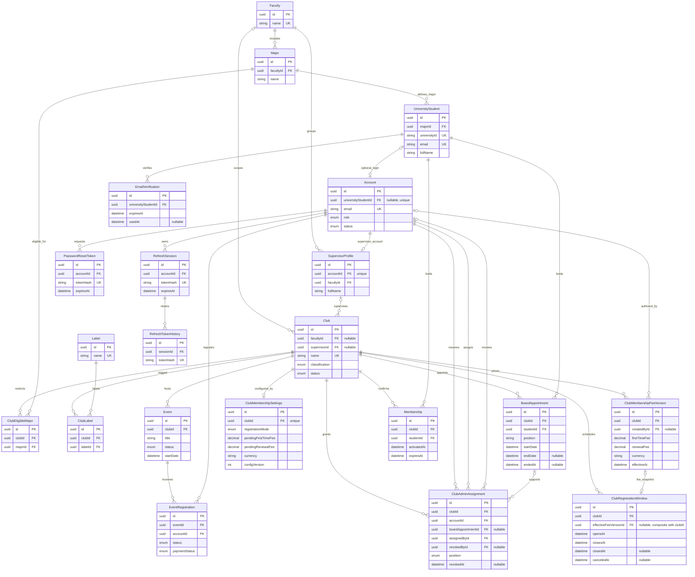

# ClubHub — Sprint 5 Architecture Closeout

**Project:** ClubHub (University Clubs Platform)  
**Sprint:** 5 — Membership configuration, fees, registration availability, and read-only membership quotations  
**Reference branch:** `feature/sprint-5-memberships`  
**Prepared:** 4 November 2026  
**Status:** Architecture documented; final closeout/merge approval **pending**

> **Source of truth:** `apps/api/prisma/schema.prisma`, the committed Sprint 5 SQL migrations, `apps/api/src/modules/clubs/clubs.controller.ts`, and `docs/sprint-5-membership-specifications.md`. This describes the implemented contract, not the superseded original sprint plan. Local validation and test results below were reported by the project team; they are not an independent production audit.

## 1. Executive summary

Sprint 5 establishes **club-level membership fees and registration policy**, immutable fee history, scheduled registration windows, an initially empty confirmed-membership history table, and **read-only, student-specific eligibility/pricing**. The Deanship administers fees and windows. Visitors can read public availability; authenticated students can read their own eligibility and quote.

Membership **applications, payment confirmation, payment-deadline enforcement, and transactional activation** belong to **Sprint 6**. Membership cards and the membership-dependent board/administrator privilege rule belong to **Sprint 7**. No successful payment or active membership is fabricated in Sprint 5.

### Sprint 5 scope accounting

| Stage | Implemented / verified | Remaining gate |
|---|---|---|
| 5.A — Technical contract | Approved revised business rules and membership model | Record any later departures as amendments |
| 5.B — Configuration foundation | Fee/settings schema, fee versioning, window schema, club-creation integration | Final code review |
| 5.C — Deanship controls | Existing Create Club / Club Detail controls connected to persistence | Final UI acceptance evidence |
| 5.D — Fee and window lifecycle | Snapshot-at-opening, fee changes, extension/closure, policy transitions, canceled-window history | Dedicated new-transition regression tests recommended |
| 5.E — Read-only history and quote | `Membership` table and active/previous-member lookups | Sprint 6 will populate confirmed records |
| 5.F — Student interface | Club page prices and availability; member/ineligible directory badges | Verify states manually; pending badge waits for applications |
| 5.G — Closeout | This architecture inventory and ERD; existing regression results | Final checklist/PR and merge approval |

## 2. Complete data-model inventory

The Prisma schema defines **21 models**. The SQL migration `20261103_sprint5_fee_opening_boundary` additionally creates **one SQL-only support table**, `ClubMembershipFeeBoundaryGuard`, for a deferred transaction-boundary check. Thus the documented implemented design has **21 Prisma models plus 1 SQL-only support table**, not 22 Prisma models.

All listed primary keys (`id`) are UUIDs. `?` denotes a nullable reference; each `@relation`-backed FK uses `ON DELETE RESTRICT` unless explicitly marked otherwise. A relationship on a non-null FK is required for the child row; nullable FKs allow a missing parent reference.

| Model | Primary key | Foreign keys / unique association | Purpose and notable uniqueness |
|---|---|---|---|
| `Faculty` | `id` | — | University faculty; `name` unique |
| `Major` | `id` | `facultyId → Faculty.id` | Academic major; `(facultyId, name)` unique |
| `UniversityStudent` | `id` | `majorId → Major.id` | Canonical university identity; `universityId`, `email` unique |
| `Account` | `id` | `universityStudentId? → UniversityStudent.id` | Login identity; `email` and optional `universityStudentId` unique |
| `EmailVerification` | `id` | `universityStudentId → UniversityStudent.id` | Student email verification attempts |
| `Club` | `id` | `facultyId? → Faculty.id`; `supervisorId? → SupervisorProfile.id` | Club profile, classification and status; `name` unique |
| `ClubEligibleMajor` | `id` | `clubId → Club.id`; `majorId → Major.id` | Club–major restriction; `(clubId, majorId)` unique |
| `Label` | `id` | — | Label catalog; `name` unique |
| `ClubLabel` | `id` | `clubId → Club.id`; `labelId → Label.id` | Club–label junction; `(clubId, labelId)` unique |
| `Event` | `id` | `clubId → Club.id` | Club events and public registration/pricing configuration |
| `EventRegistration` | `id` | `eventId → Event.id`; `accountId → Account.id` | Event-specific registration/payment status; `(eventId, accountId)` unique |
| `RefreshSession` | `id` | `accountId → Account.id` (**CASCADE**) | Account refresh sessions; `tokenHash` unique |
| `RefreshTokenHistory` | `id` | `sessionId → RefreshSession.id` (**CASCADE**) | Rotated token history; `tokenHash` unique |
| `PasswordResetToken` | `id` | `accountId → Account.id` (**CASCADE**) | Password-reset audit; `tokenHash` unique |
| `SupervisorProfile` | `id` | `accountId → Account.id`; `facultyId → Faculty.id` | Supervisor identity/profile; `accountId` unique |
| `ClubAdminAssignment` | `id` | `clubId → Club.id`; `accountId → Account.id`; `boardAppointmentId? → BoardAppointment.id`; `assignedById → Account.id`; `revokedById? → Account.id` | Club-scoped, revocable administrator grants |
| `BoardAppointment` | `id` | `clubId → Club.id`; `studentId → UniversityStudent.id` | Dated club board appointments, separate from administrator grants |
| **`ClubMembershipSettings`** | `id` | `clubId → Club.id` | One settings record per club; `clubId` unique |
| **`ClubMembershipFeeVersion`** | `id` | `clubId → Club.id`; `createdById? → Account.id` | Immutable effective price snapshots; composite `(id, clubId)` unique |
| **`ClubRegistrationWindow`** | `id` | `clubId → Club.id`; **composite** `(effectiveFeeVersionId?, clubId) → ClubMembershipFeeVersion.(id, clubId)` | Scheduled, closed, or canceled registration windows; snapshot association nullable |
| **`Membership`** | `id` | `clubId → Club.id`; `studentId → UniversityStudent.id` | Only confirmed membership history; activation and expiration instants |

**SQL-only table:** `ClubMembershipFeeBoundaryGuard(id UUID PK, clubId UUID, mutationAt TIMESTAMPTZ)`. It is a transient transactional guard, not a domain membership entity, and is not represented in Prisma. Its `clubId` is used in the deferred check; the reviewed creation SQL does **not** declare a foreign-key constraint for that field.

## 3. Complete ERD — all 21 Prisma models

The diagram shows **every Prisma model**, each model's primary key, **all declared foreign-key columns**, and its principal domain fields. It omits repetitive audit columns from some boxes to keep the diagram legible; the schema remains the authoritative full column specification. A `?` in a field label signifies nullable. SQL-only `ClubMembershipFeeBoundaryGuard` is documented separately after the diagram.



**Cardinality notes:** Nullable `Club.facultyId`, `Club.supervisorId`, `Account.universityStudentId`, `ClubAdminAssignment.boardAppointmentId`, and `ClubRegistrationWindow.effectiveFeeVersionId` permit absent links. `ClubMembershipSettings.clubId` is unique, so one club has **zero or one** settings row. Fee snapshots belong to the **same club** as the referencing window through the composite FK. A unique partial SQL index restricts an effective fee version to **at most one window**, despite the schema-level Prisma relation being modeled as a list. The diagram's notation abstracts FK direction and optionality; read this paragraph and the table for exact constraints.

### 3.1 SQL-only concurrency support

```text
ClubMembershipFeeBoundaryGuard
  id          UUID PRIMARY KEY
  clubId      UUID NOT NULL  (no declared FK in reviewed SQL)
  mutationAt  TIMESTAMPTZ NOT NULL
```

`membership_fee_boundary_commit_check` is a **deferred constraint trigger**. For a membership-settings mutation, the guard records the mutation timestamp and checks at commit whether a scheduled registration opening occurred during the transaction. A conflict raises SQLSTATE `40001` and prevents the fee mutation from silently crossing the opening boundary. The trigger removes the transient guard row in normal successful processing.

## 4. Membership invariants and SQL safeguards

| Invariant | Enforcement and source |
|---|---|
| Fees must be positive | SQL `CHECK`s on pending settings and effective fee versions in `20261031114602_sprint5_membership_foundation` |
| Registration `closesAt > opensAt` | `membership_window_valid_interval` check |
| Early closure must fall within scheduled interval | `membership_window_valid_closure` check |
| Canceled window is future, not fee-locked, and not early-closed | `membership_window_valid_cancellation` check plus `protect_membership_registration_window` trigger |
| Windows of a club cannot overlap while still effective | GiST exclusion constraint `membership_window_no_overlap`, using an **empty range for canceled windows** and a shortened range for early closure |
| Canceled/closed/expired windows retain history | Window protection trigger blocks deletion and modifications of historical windows, with narrow one-time historical fee-link recovery |
| A fee snapshot belongs to its club's window | Composite FK `membership_window_fee_same_club` on `(effectiveFeeVersionId, clubId)` |
| Fee snapshot is immutable | `membership_fee_version_immutable` update/delete trigger |
| A locked snapshot cannot be changed | Registration-window protection trigger |
| One fee version is not shared between different windows | Partial unique index `membership_window_unique_effective_fee_version` |
| Windows lock fees when due, not merely when scheduled | `snapshot_due_membership_windows`, periodic reconciler, and settings-change trigger |
| Fee/mode change cannot silently cross window opening | Deferred `membership_fee_boundary_commit_check` |
| Confirmed membership expires after activation | SQL `Membership_valid_dates_check` (`expiresAt > activatedAt`) |

**Important:** Constraints implemented in migrations (partial indexes, GiST exclusion, triggers, composite FKs, and deferred checks) may not be fully represented by Prisma's schema DSL. Do not replace the database with `prisma db push` or erase the migration history to regenerate it. The existence of a historical `Membership` row does **not** by itself prove payment confirmation; payment provenance is planned for Sprint 6.

## 5. Implemented membership API contract

These are the **actual controller routes** verified in `apps/api/src/modules/clubs/clubs.controller.ts`, not speculative `/api/v1` endpoints. Nest routes are declared under `@Controller('clubs')`; the web application accesses them through its `/api` proxy.

| Method | Nest route | Access | Main purpose / input |
|---|---|---|---|
| `POST` | `/clubs` | Deanship | Create a club, including mandatory membership fee/policy configuration in `CreateClubDto` |
| `GET` | `/clubs/admin/:id` | Deanship | Read full management detail, including membership settings and windows |
| `POST` | `/clubs/:id/membership/initialize` | Deanship | Initialize membership configuration on an existing club (legacy backfill) |
| `PATCH` | `/clubs/:id/membership/fees` | Deanship | `{ firstTimeFee: string, renewalFee: string, configVersion: int }`; positive values are enforced by service/DB |
| `PATCH` | `/clubs/:id/membership/mode` | Deanship | `{ registrationMode: 'ALWAYS_OPEN' \| 'WINDOWED', configVersion: int }` |
| `POST` | `/clubs/:id/membership/windows` | Deanship | `{ opensAt: ISO8601 string, closesAt: ISO8601 string }` |
| `PATCH` | `/clubs/:id/membership/windows/:windowId` | Deanship | Edit a permitted future registration window |
| `PATCH` | `/clubs/:id/membership/windows/:windowId/extend` | Deanship | Extend an actively open registration window while preserving its locked fee version |
| `PATCH` | `/clubs/:id/membership/windows/:windowId/cancel` | Deanship | Cancel an individual future, unlocked registration window while preserving its history |
| `PATCH` | `/clubs/:id/membership/windows/:windowId/close` | Deanship | Close an active window early; retain historical closure |
| `GET` | `/clubs/:id/membership/availability` | Public | Server-authoritative registration state, selected window, effective fees |
| `GET` | `/clubs/:id/eligibility/me` | Student | Academic eligibility **plus** personal membership state/quote |

`GET /clubs` and `GET /clubs/:id` remain public club-discovery routes. Membership fee/mode/window **write operations are Deanship-only** via JWT and roles guards. `configVersion` provides optimistic concurrency protection for settings changes. The windows DTO uses strict ISO-8601 timestamps. These exact DTOs do not include an application submission or payment field.

### 5.1 Public availability response

`GET /clubs/:id/membership/availability` returns:

```ts
{
  clubId: string;
  registrationMode: 'ALWAYS_OPEN' | 'WINDOWED' | null;
  status:
    | 'ALWAYS_OPEN' | 'SCHEDULED' | 'OPEN' | 'CLOSED'
    | 'CLOSED_EARLY' | 'NOT_SCHEDULED'
    | 'NOT_CONFIGURED' | 'CLUB_ARCHIVED';
  registrationAvailable: boolean;
  effectiveFees: {
    firstTimeFee: string;
    renewalFee: string;
    currency: string;
    feeVersionId: string;
    effectiveAt: string; // serialized Date
  } | null;
  window: {
    id: string;
    opensAt: string;
    closesAt: string;
    closedAt: string | null;
    effectiveFeeVersionId: string | null;
  } | null;
  checkedAt: string; // serialized Date
}
```

### 5.2 Personalized eligibility and quote

The existing endpoint `GET /clubs/:id/eligibility/me` combines `ClubEligibilityService.evaluateForAccount` with `ClubsService.getMembershipQuoteForAccount`. Its membership extension exposes:

```ts
membership: {
  registrationAvailable: boolean;
  availabilityStatus: MembershipAvailabilityStatus;
  alreadyActiveMember: boolean;
  activeMembershipExpiresAt: string | null; // Date after serialization
  hasPreviousMembership: boolean;
  canApply: boolean;
  feeType: 'FIRST_TIME' | 'RENEWAL' | null;
  amount: string | null;
  currency: string | null;
  feeVersionId: string | null;
}
```

Renewal is determined by **any previous confirmed `Membership`** for the same student/club, even if expired. An already active member must not apply early. An application will later preserve its quoted price when Sprint 6 introduces persistence.

## 6. UI integration and current boundaries

| UI surface | Implemented Sprint 5 behavior | Boundary |
|---|---|---|
| Deanship — Create Club | Required first-time and renewal fees and registration mode/window | Deanship-only actions |
| Deanship — Club Detail | Load/edit fees, change mode, create/edit/close windows, show canceled history | Preserves fee/version history |
| Public club page | Public registration status and published effective fees; sign-in prompt | No personalized details for visitors |
| Student club page | Personal first-time/renewal quote, eligibility reason, active member, window messaging | Application button intentionally disabled until Sprint 6 |
| Home and club directory cards | Active **Member** badge; **Not eligible** for ineligible students; eligible student has no badge | **Pending** requires real Sprint 6 application records; visitors show no personalized badge |

The club-card function `useClubEligibility` currently calls the authenticated eligibility endpoint per club; performance/rate considerations may warrant batching later if the catalog grows. This is an implementation observation, not a Sprint 5 completion blocker.

### 6.1 Post-merge UI and timezone corrections

The Sprint 5 post-merge correction branch completed the following frontend integrations:

| Surface | Implemented behavior |
|---|---|
| Deanship — Create Club | Membership fee fields consistently display ILS rather than dollar symbols. Registration dates are converted using Palestine-local calendar boundaries. |
| Deanship — Club Management Detail | Active registration windows expose a dedicated Extend action. Future, unlocked registration windows expose individual cancellation controls. |
| Public club cards | Cards retrieve the public membership-availability endpoint and display published prices or appropriate scheduled, closed, or unavailable states. |
| Student club page | Registration dates and inclusive closing-day messages are displayed in Palestine time. |
| Shared date utility | `apps/web/src/utils/membershipDates.ts` centralizes membership registration date conversion and formatting. |

**Registration timezone:** `Asia/Hebron`.

The UI interprets a selected opening date as midnight at the beginning of that date in Palestine.

A selected closing date is inclusive for users. The API stores its exclusive boundary at midnight at the beginning of the following Palestine-local calendar day.

For example, a selected last registration day of 20 November 2026 is stored as `2026-11-20T22:00:00.000Z`, equivalent to midnight on 21 November in Palestine.

These conversions are independent of the browser's local timezone and account for applicable daylight-saving offsets.

Membership pricing and registration availability remain server-authoritative. Public visitors do not receive personalized eligibility or membership information.

Student membership applications and payments remain deferred to Sprint 6.
## 7. Deviations from the original sprint plan

| Original proposal | Approved / implemented behavior |
|---|---|
| Global `MembershipPeriod` per academic year | **No global membership period**. Membership expires one year after individual confirmation/activation. |
| `ClubFee` per period | Persistent per-club pending first-time and renewal fees plus immutable effective `ClubMembershipFeeVersion` rows |
| Only a period-based price check | Registration-window availability + academic eligibility + confirmed-membership renewal lookup |
| Generic eligibility-rule table | Reuse Sprint 4 `Club.classification`, optional faculty FK, and `ClubEligibleMajor` |
| Shared CLUB-role administrator login | Reuse Sprint 3–4 named `STUDENT` accounts and board-linked `ClubAdminAssignment` |

Business-rule authority: `docs/sprint-5-membership-specifications.md`; additional historical departures: `docs/sprint-logic-changes.md`. The original `docs/clubs-platform-sprint-plan.md` is kept as a historical baseline, not silently rewritten.

## 8. Verification evidence and outstanding work

### Reported local verification

- Prisma schema validation: **passed** (`npx prisma validate`).
- Prisma migration status on `clubhub_dev`: **20 migrations found; database schema up to date**.
- API build: **passed**.
- Web build: **passed**.
- API Jest run against the dedicated `clubhub_test` database: **18 suites passed; 228 tests passed**.
- Live registration mode switching and date restrictions: **reported passed by the team**.
- `git diff --check` for recent club-card change: **passed**.
- Web ESLint: **not clean**. Pre-existing `react-refresh/only-export-components` diagnostics in `ClubCard.tsx` and other existing lint debt remain; the newly introduced effect-state violation was corrected. Do not describe the whole frontend as lint-clean.

### Remaining closeout gates

1. Verify **and record** UI acceptance for visitor, eligible/ineligible student, previous confirmed membership, active member, scheduled/closed registration, loading/error states. Some states may require controlled test fixtures, not production fabrication.
2. Add or review targeted **database-backed regression cases for the newly added mode transitions**, canceled-window overlap, and opening-time races. The existing green 228-test baseline does not by itself prove every new transition.
3. Review the untracked `docs/sprint-5d-lifecycle-verification.md` for inclusion in the PR, preserving its evidence and resolving any outstanding checklist items.
4. Confirm branch state, run final builds/tests and migration status, review the changes in the pull request, and obtain approval before merging Sprint 5 into `main`.
5. Track existing ESLint/Fast Refresh technical debt separately, rather than rewriting unrelated UI during sprint closeout.

**Sprint 5 closure recommendation:** **Ready for final acceptance review, not automatically closed by creation of this document.**

### Post-merge correction verification — 5 November 2026

Following the original Sprint 5 merge, five corrections were implemented on `feature/sprint-5-post-merge-fixes`.

The corrections cover active-window extension, individual scheduled-window cancellation, ILS currency labels, public club-card membership pricing, and Asia/Hebron registration-date consistency.

#### Local verification

| Check | Result |
|---|---|
| PostgreSQL membership lifecycle integration tests | 36/36 passed |
| Permanent timezone regression tests | 8/8 passed |
| Full API Jest suite | Passed |
| API production build | Passed |
| Frontend production build | Passed |
| Git whitespace validation | Passed |
| Scheduled-window cancellation browser acceptance | Passed |
| Active-window extension browser acceptance | Passed |
| Public club-card pricing browser acceptance | Passed |

The PostgreSQL tests ran against the isolated `clubhub_test` database. Temporary manual-acceptance fixtures were not added to the source-code branch.

The extension browser test confirmed that an active window remained open after its closing date was extended. PostgreSQL verification confirmed the persisted closing timestamp, unchanged window identity, and presence of its locked fee version.

These results represent local verification, not production deployment or GitHub CI approval.

#### Remaining closeout requirements

1. Review the complete correction-branch Git diff.
2. Commit and push the correction branch.
3. Create and review the pull request.
4. Confirm GitHub CI results and merge into `main`.
5. Restore the normal development API connection to `clubhub_dev`.

**Status:** Post-merge correction implementation and local verification complete. Repository closeout remains pending.

For detailed lifecycle evidence and tracked follow-up issues, see `docs/sprint-5d-lifecycle-verification.md`.
## 9. Sprint 6 / 7 handoff

**Sprint 6 — membership applications and payments:** Add persisted application and payment entities with audit history, immutable quoted fee/currency and fee-version provenance, pending/deadline status, unique pending-application enforcement, cancellation/expiration, secure manual/online payment confirmation, and atomic activation of confirmed `Membership` rows. Registration closure/extension/policy switches must update or invalidate unpaid applications consistently and safely under concurrent payment attempts. Avoid granting membership on application submission.

**Sprint 7 — membership card and effective privileges:** Render verified membership cards, member lists, and enforce active paid membership when computing effective board/club administrator privileges. Preserve existing appointments and administrator assignments when a member's privileges become suspended; do not rewrite history or retroactively fabricate payments.

## 10. Source references

- `apps/api/prisma/schema.prisma` — actual Prisma relationships and scalar types (21 models).
- `apps/api/prisma/migrations/20261031114602_sprint5_membership_foundation/migration.sql` — fee integrity, window constraints, fee history protection.
- `apps/api/prisma/migrations/20261102_sprint5_automatic_membership_activation/migration.sql` — fee snapshot worker function, settings-trigger sweep, unique window fee snapshot.
- `apps/api/prisma/migrations/20261103_sprint5_fee_opening_boundary/migration.sql` — SQL-only guard table and deferred commit boundary.
- `apps/api/prisma/migrations/20261103_sprint5_window_policy_transitions/migration.sql` — canceled window history and overlap rules.
- `apps/api/prisma/migrations/20261103_sprint5e_membership_history/migration.sql` — confirmed-membership history.
- `apps/api/src/modules/clubs/clubs.controller.ts` and `dto/` — authoritative controller paths and DTOs.
- `apps/api/src/modules/clubs/membership-availability.types.ts` — public availability response.
- `docs/sprint-5-membership-specifications.md` — approved Sprint 5 membership decisions.
- `docs/sprint-logic-changes.md` — historical Sprint 3–4 decisions.
- `docs/clubs-platform-sprint-plan.md` — original sprint baseline.

---

**For repository inclusion:** Save at `docs/sprint-5-architecture-closeout.md`, review the Mermaid diagram in GitHub preview, and commit it only after the team confirms the final acceptance evidence and remaining gates.
